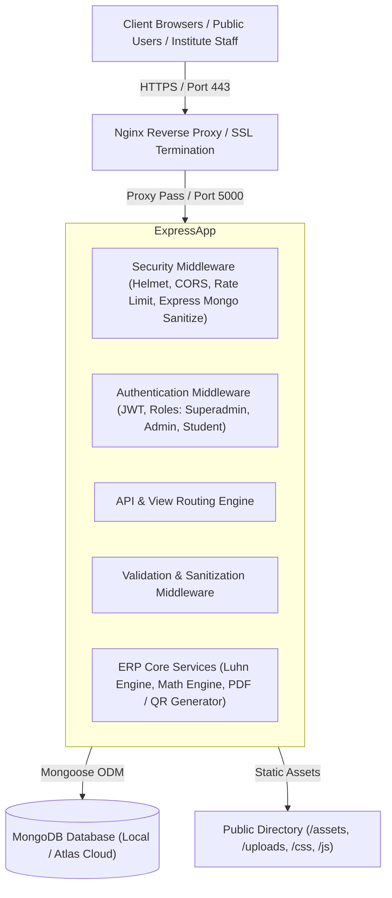

# System Architecture & Technical Specifications
## Usha Institute of Computer Education (ATC: IN/UP/MAU/29172)

---

### 1. Architectural Overview

The system is designed as an enterprise-grade Educational Resource Planning (ERP) and Student Document Verification platform built on the **PERN/MERN-variant Node.js architecture** (Node.js, Express, MongoDB with Mongoose, and Server-Side Dynamic Frontends with Component Architecture).

---

### 2. Layered Component Architecture

#### 2.1 Presentation & Rendering Layer (`public/`)
- **Shared Design System**: Single unified design language defined by CSS variables in `public/css/style.css` (primary brand color `#0b1230` navy, secondary `#c9a45c` heritage gold, neutral dark `#1e293b`).
- **Modular Component Mounting**:
  - `public/js/components.js`: Injects standardized `<header>` (`siteHeaderMount`) and `<footer>` (`siteFooterMount`) on all public pages, guaranteeing identical navigation, contact details, affiliation text, and accreditation badges.
- **Dedicated Document Portals**:
  - `public/certificate.html`: Landscape A4 certificate verification canvas (1580px × 1100px) with fallback API cascading.
  - `public/result.html`: Portrait A4 Statement of Marks canvas (720px × 1041px) matching official physical marksheet layout with dynamic calculation engine.
  - `public/admit-card.html`: Portrait A4 Hall Ticket canvas (850px × 1100px) supporting multi-date, multi-shift exam timetables.
  - `public/admin.html`: Administrative console with role-based tabs (Admissions, Students, Marks, Certificates, Payments, Batches, Courses, Exams, Settings).

#### 2.2 Controller & Routing Layer (`routes/`)
- `routes/authRoutes.js`: Login, session validation (`/api/auth/login`, `/api/auth/me`), password hashing with `bcryptjs`.
- `routes/adminRoutes.js`:
  - Student CRUD, photo upload (`/api/admin/upload-photo`, `/api/admin/students/:id/photo`).
  - Dynamic Curriculum management (`/api/admin/courses`).
  - Multi-date exam timetabling (`/api/admin/exams`).
  - Marks entry with automatic arithmetic verification (`/api/admin/results`).
  - Fee collection and receipt generation (`/api/admin/payments`).
- `routes/studentRoutes.js`: Public search & verification endpoints with sensitive field masking (Aadhaar, mobile, address omitted in public responses).
- `routes/admissionRoutes.js`: Online application ingestion, DPDP-compliant Aadhaar storage, workflow approval.
- `routes/paymentRoutes.js`: UPI proof submission, 12-digit UTR reconciliation, counter cash collection.
- `routes/batchRoutes.js`: Batch scheduling, clash detection, daily student attendance marking.

#### 2.3 Data Modeling Layer (`models/`)
- `models/Student.js`: Complete student demographic record, academic identifiers (`appNo`, `registrationNo`, `enrollmentNo`, `rollNo`), and fee tracking.
- `models/Course.js`: Course curriculum definition, duration, fee plan, and dynamic subject lists with max and passing marks.
- `models/Exam.js`: Multi-subject examination timetables, shift timings, dates, and venues.
- `models/Result.js`: Statement of Marks storage with pre-save hooks executing mathematical totalization and exact half-up rounding.
- `models/Certificate.js`: Official certification metadata, serial numbers, marksheet numbers, and cryptographic QR code verification URLs.
- `models/Payment.js`: Transaction logs, receipt sequence (`UICE/REC/...`), method classification (UPI / Cash), and verification state.
- `models/Counter.js`: Atomic sequence generators for numbering schemes.
- `models/Settings.js`: Institutional profile constants, payment VPAs, center codes, and grading scales.

---

### 3. Core Business Invariants & Algorithms

1. **Luhn 12-Digit Enrollment Generator**:
   - Enrollment numbers generated using the standard Luhn modulo 10 algorithm (`utils/numberGenerator.js`).
   - Ensures check-digit verification prevents single-digit typographical errors.
2. **Exact Decimal Half-Up Rounding**:
   - Floating point arithmetic errors avoided using integer-scaled calculation:
     $$\text{percentage} = \frac{\lfloor (\text{totalObtained} / \text{totalMax}) \times 10000 + 0.5 \rfloor}{100}$$
   - Guarantees $637 / 800 = 79.625$ rounds unambiguously to $79.63\%$.
3. **Fail-Safe Grade & Status Integrity**:
   - If any subject score is lower than the passing threshold ($40$), the overall result is strictly enforced as `Fail` and overall grade as `F`, preventing grade/result discrepancies.
4. **Search Guard**:
   - Canvas elements for certificates, marksheets, and admit cards remain concealed on fresh page visits until an explicit query parameter or user search action is performed.
